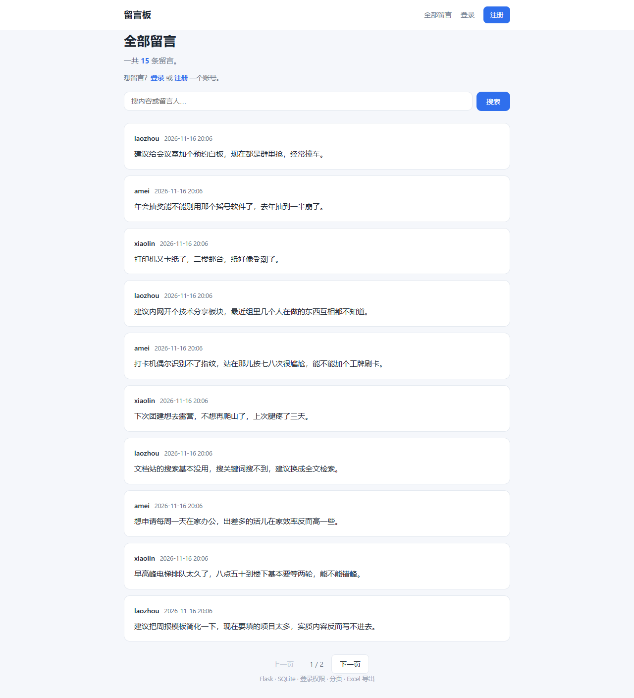
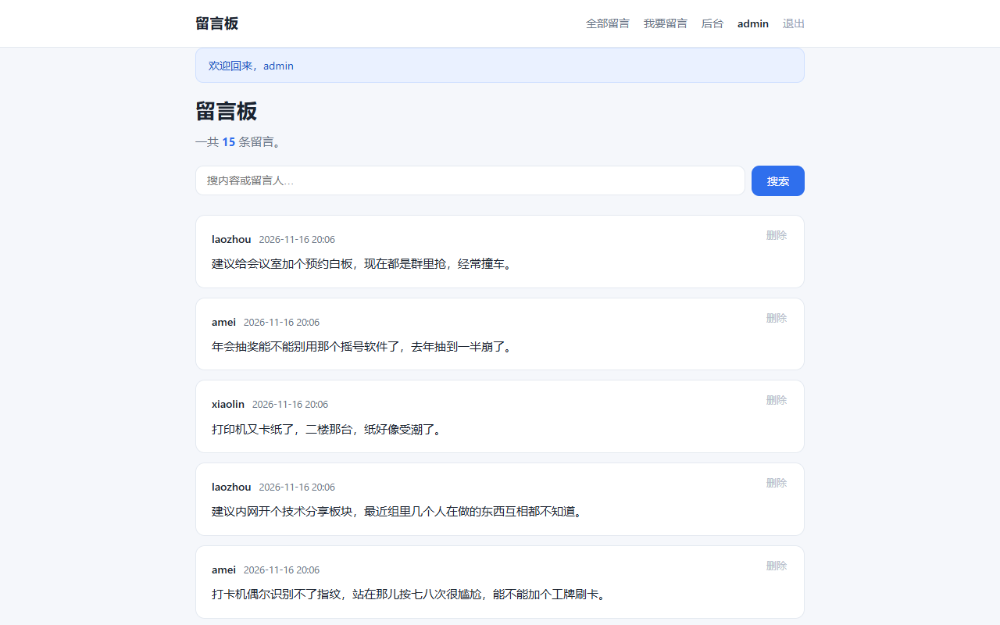
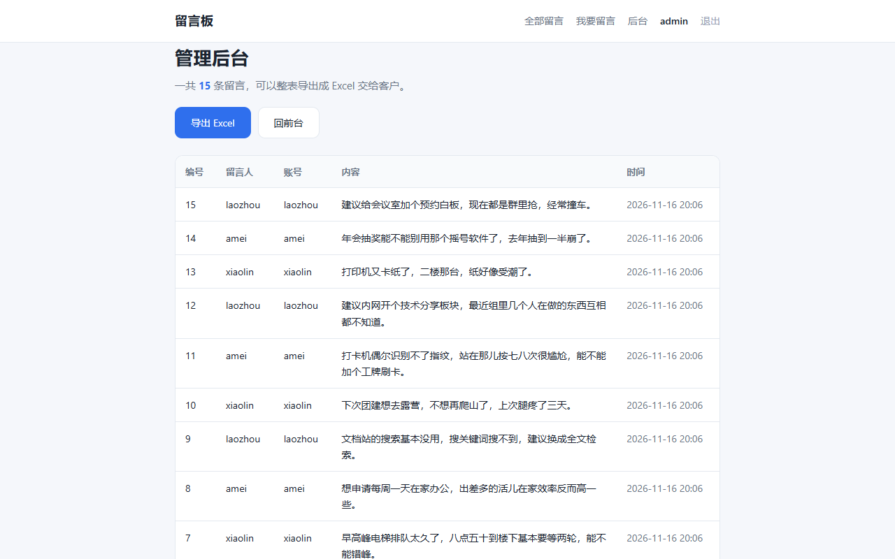

# 留言板 Message Wall

一个可以直接交付的小型留言 / 反馈收集系统，基于 Flask + SQLite。
适合企业内部意见箱、活动留言墙、客户反馈收集这类场景，部署成本低，数据全在自己手里。

## 功能

- **多用户**：注册、登录、登出，密码用 werkzeug 的 scrypt 哈希存储，不存明文
- **留言**：登录后可发布，支持换行，单条最长 500 字
- **权限**：留言只能由作者本人或管理员删除，前端也会按权限隐藏按钮
- **搜索**：按内容或留言人模糊搜索
- **分页**：每页 10 条，带页码导航
- **管理后台**：查看全部留言，一键导出 Excel（openpyxl，带表头样式、冻结首行、自动筛选）
- **响应式**：手机宽度下自动换行、缩小间距
- **自定义 404**

## 截图

| 访客视角 | 登录后首页 | 管理后台 |
|---|---|---|
|  |  |  |

## 技术栈

| 层 | 选型 |
|---|---|
| Web 框架 | Flask 3.1 |
| 数据库 | SQLite（`sqlite3` 标准库，无 ORM 依赖） |
| 模板 | Jinja2 |
| 密码 | `werkzeug.security`（scrypt + 随机盐） |
| 导出 | openpyxl |
| 前端 | 原生 HTML/CSS，无框架 |

选 SQLite 和原生 CSS 是为了**部署简单**：一台最便宜的服务器、甚至一个免费容器就能跑，不需要装数据库服务和前端构建链。

## 快速开始

```bash
pip install -r requirements.txt
python app.py
```

打开 http://127.0.0.1:5000

首次启动会自动建表，并创建一个管理员账号（默认 `admin / admin123`）。
**上线前请通过环境变量改掉：**

```bash
export MW_ADMIN_USER=your_name
export MW_ADMIN_PASSWORD=your_password
export MW_SECRET_KEY=$(python -c "import secrets;print(secrets.token_hex(16))")
```

在 Windows PowerShell 里对应 `$env:MW_ADMIN_USER="your_name"`。

## 目录结构

```
message-wall/
├── app.py              # 路由与业务流程
├── db.py               # 数据访问层（所有 SQL 都在这里）
├── auth.py             # 密码哈希、登录校验、权限装饰器
├── export.py           # Excel 导出
├── templates/
│   ├── base.html       # 布局骨架
│   ├── index.html      # 首页：列表 + 搜索 + 分页
│   ├── form.html       # 发布留言
│   ├── login.html / register.html / admin.html / 404.html
├── static/style.css    # 全部样式（约 300 行，含移动端适配）
├── tests/selftest.py   # 21 项自动化检查
└── requirements.txt
```

分层意图：`app.py` 只管「收到请求做什么」，`db.py` 只管「怎么读写数据」。
以后要把 SQLite 换成 MySQL/PostgreSQL，只需要改 `db.py` 一个文件。

## 运行测试

```bash
python tests/selftest.py
```

输出 21 项检查结果，覆盖：未登录拦截、注册校验、密码强度、重复用户名、错误密码、发布与空内容、搜索命中与无结果、普通用户越权访问后台、管理员权限、Excel 导出文件合法性（校验 xlsx 的 `PK` 文件头）、分页、404、以及**密码确实是哈希存储**。

```
21 passed, 0 failed
```

## 部署

### Render（免费方案）

1. 把仓库连到 Render，New → Web Service，语言选 Python
2. Build Command：`pip install -r requirements.txt`
3. Start Command：`gunicorn app:app`
4. 环境变量加 `MW_SECRET_KEY`、`MW_ADMIN_USER`、`MW_ADMIN_PASSWORD`（**别用默认密码上线**）
5. 部署完成会拿到 `https://xxx.onrender.com`

两个免费实例的注意事项：

- 15 分钟无访问会休眠，下次访问要等约 50 秒冷启动
- 没有持久磁盘，重新部署后 `messages.db` 会重置。演示够用，正式用请挂 Render Disk 或改用 PostgreSQL

### 其他平台

`gunicorn app:app` 可以跑在任何支持 Python 的服务器。PythonAnywhere 免费版也行（WSGI 指向 `app:app`）。

## 已知限制

- 没有做登录失败次数限制（暴力破解防护需要配合 Nginx 或 Flask-Limiter）
- 没有找回密码功能，忘了只能让管理员在数据库改
- 单进程 SQLite，写入并发很高时会有锁竞争；这类场景应换 PostgreSQL
- 没有做留言的富文本编辑，纯文本

## License

MIT
